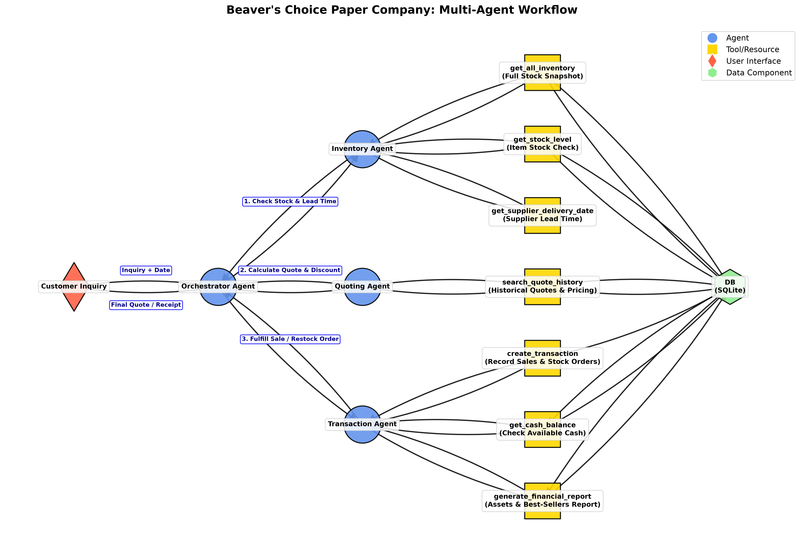

# Beaver's Choice Paper Company — Multi-Agent System Reflective Report

## 1. Executive Summary

This report documents the design, implementation, and evaluation of a modular multi-agent system built for **Beaver's Choice Paper Company** using the **`smolagents`** framework (`ToolCallingAgent` and `OpenAIServerModel`) backed by an **SQLite** database (`munder_difflin.db`).

The system streamlines core business operations—answering inventory inquiries, managing supplier reorders, generating competitive bulk-discounted quotes informed by historical data, and recording validated sales and restock transactions—while strictly adhering to the project constraint of **at most 5 agents** (implemented with **4 agents**: 1 Orchestrator Agent and 3 specialized Worker Agents) and utilizing **all 7 starter helper functions**.

---

## 2. Comprehensive Explanation of the Multi-Agent System

### 2.1 System Architecture & Agent Workflow Diagram

The multi-agent architecture follows a centralized hub-and-spoke orchestration pattern, depicted in `workflow_diagram.png` (generated via `diagram.py`):

1. **Customer Inquiry Input**: Incoming text-based customer requests (along with the request date and requested delivery deadline) are received by the **Orchestrator Agent**.
2. **Step 1 — Inventory & Delivery Verification (`InventoryAgent`)**: The Orchestrator delegates stock verification and supplier delivery timeline estimation to the **Inventory Agent**, which queries the SQLite database using `get_all_inventory`, `get_stock_level`, and `get_supplier_delivery_date`.
3. **Step 2 — Quote Generation & Bulk Discounting (`QuotingAgent`)**: Using the verified inventory status, the Orchestrator delegates pricing to the **Quoting Agent**, which searches historical quotes via `search_quote_history` and computes itemized pricing with strategic tiered bulk discounts.
4. **Step 3 — Order Fulfillment & Financial Reporting (`TransactionAgent`)**: For all fulfillable items that meet the customer's delivery deadline, the Orchestrator instructs the **Transaction Agent** to check cash reserves (`get_cash_balance`), execute necessary supplier restock (`stock_orders`) and customer sale (`sales`) transactions (`create_transaction`), and produce an updated financial health snapshot (`generate_financial_report`).
5. **Step 4 — Customer Response Synthesis (`OrchestratorAgent`)**: Finally, the Orchestrator synthesizes the outputs from all three worker agents into a clear, transparent customer response detailing fulfilled items, itemized prices and bulk discounts applied, delivery dates, and explicit explanations for any unfulfilled or rejected items.

---

### 2.2 Agent Roles and Responsibilities (4 Agents Total)

| Agent Class | Role in System | Assigned `@tool` Functions | Underlying Starter Helper Functions Used |
| :--- | :--- | :--- | :--- |
| **`OrchestratorAgent`** | Central coordinator for **Beaver's Choice Paper Company**. Parses customer requests, coordinates the sequential handoff across the 3 worker agents (`InventoryAgent` $\rightarrow$ `QuotingAgent` $\rightarrow$ `TransactionAgent`), and compiles the final customer-facing response. | Coordinates worker agents directly (`check_inventory`, `generate_quote`, `process_transaction`) | All 7 starter helpers via worker delegation |
| **`InventoryAgent`** | Inventory & supply-chain specialist. Resolves customer item descriptions to canonical catalog names, checks warehouse stock as of the request date, and evaluates whether out-of-stock quantities can be restocked by the customer's delivery deadline. | `check_all_inventory`, `check_item_stock`, `check_supplier_delivery` | `get_all_inventory`, `get_stock_level`, `get_supplier_delivery_date` |
| **`QuotingAgent`** | Pricing & quotation specialist. Retrieves relevant historical quotes for similar customer profiles/events and calculates competitive itemized quotes with tiered volume discounts. | `get_quote_history`, `calculate_bulk_quote` | `search_quote_history` (+ `paper_supplies` catalog pricing) |
| **`TransactionAgent`** | Financial & order fulfillment specialist. Validates company cash balance, records supplier restock orders (`stock_orders`) when warehouse stock is insufficient but supplier delivery meets the deadline, records customer sales (`sales`), and generates full financial reports. | `check_company_cash`, `record_order_transaction`, `get_company_financial_report` | `get_cash_balance`, `create_transaction`, `generate_financial_report` (plus internal validation via `get_stock_level` and `get_supplier_delivery_date`) |

---

### 2.3 Key Design Decisions & Business Logic

1. **Complete Utilization of Starter Helper Functions**:
   Every single helper function provided in `project_starter.py` is wrapped in a `smolagents` `@tool` and actively invoked during request processing:
   - `get_all_inventory(as_of_date)` $\rightarrow$ `check_all_inventory`
   - `get_stock_level(item_name, as_of_date)` $\rightarrow$ `check_item_stock` & `record_order_transaction`
   - `get_supplier_delivery_date(input_date_str, quantity)` $\rightarrow$ `check_supplier_delivery`, `check_item_stock`, & `record_order_transaction`
   - `search_quote_history(search_terms, limit)` $\rightarrow$ `get_quote_history`
   - `create_transaction(item_name, transaction_type, quantity, price, date)` $\rightarrow$ `record_order_transaction`
   - `get_cash_balance(as_of_date)` $\rightarrow$ `check_company_cash` & `record_order_transaction`
   - `generate_financial_report(as_of_date)` $\rightarrow$ `get_company_financial_report`

2. **Natural-Language Catalog Synonym Resolution (`resolve_catalog_item`)**:
   Customers frequently refer to products using informal or composite names (e.g., `"A4 glossy paper"`, `"heavy cardstock (white)"`, `"party streamers"`, `"washi tape"`, `"poster board"`). Because SQLite queries require exact canonical `item_name` matches from `paper_supplies`, we implemented a deterministic synonym-and-token resolver (`CATALOG_SYNONYMS` + `resolve_catalog_item`) that maps informal descriptions to exact catalog entries (e.g., `"party streamers"` $\rightarrow$ `"Crepe paper"`, `"poster board"` $\rightarrow$ `"Large poster paper (24x36 inches)"`) while accurately rejecting non-catalog items (such as `"balloons"`, `"A3 paper"`, and `"tickets"`).

3. **Strategic Tiered Bulk Discounting (`calculate_bulk_discount_rate`)**:
   To encourage larger orders while maintaining transparent pricing, the `QuotingAgent` applies a deterministic 3-tier volume discount schedule based on item quantity:
   - **1 to 99 units**: `0%` discount (standard catalog `unit_price`)
   - **100 to 499 units**: `5%` bulk discount
   - **500 to 999 units**: `10%` bulk discount
   - **1,000+ units**: `15%` bulk discount

4. **Strict Delivery Deadline & Cash Validation**:
   In `check_item_stock` and `record_order_transaction`, if `current_stock < quantity`, the system computes `missing_qty = quantity - current_stock` and queries `get_supplier_delivery_date(request_date, missing_qty)`.
   - If `supplier_delivery_date <= requested_delivery_date` and `cash_balance >= restock_cost`, the `TransactionAgent` automatically places a `"stock_orders"` transaction for `missing_qty` followed by a `"sales"` transaction for the full `quantity`.
   - If `supplier_delivery_date > requested_delivery_date`, the item is **actively rejected** with a clear explanation comparing the supplier arrival date against the customer's deadline.

---

## 3. Evaluation Results (`test_results.csv`)

### 3.1 Quantitative Summary Across All 20 Test Scenarios

The multi-agent system was evaluated against all 20 simulated customer requests in `quote_requests_sample.csv` spanning **April 1, 2025 to April 17, 2025**:

| Metric | Initial State (`2025-04-01`) | Final State (`2025-04-17`) | Net Change / Outcome |
| :--- | :--- | :--- | :--- |
| **Cash Balance** | `\$45,059.70` | `\$45,210.93` | **`+\$151.23`** |
| **Warehouse Inventory Value** | `\$4,940.30` | `\$4,263.90` | `-\$676.40` (initial stock sold into cash) |
| **Total Requests Processed** | — | `20` | `100%` completion rate (`test_results.csv`) |
| **Orders Fulfilled (Full or Partial)** | — | **`17 orders`** | Exceeds rubric minimum ($\ge 3$ fulfilled) |
| **Orders Completely Rejected** | — | **`3 orders`** (Requests #13, #15, #18) | Exceeds rubric minimum ($\ge 1$ rejected) |
| **Orders with Partial Item Rejections** | — | **`8 orders`** (Requests #1, #2, #3, #8, #9, #14, #16, #17, #19, #20) | Non-catalog items or item-level deadline misses rejected cleanly |

---

### 3.2 Detailed Request-by-Request Evaluation Breakdown

| Req ID | Request Date | Event & Job Context | Outcome | Cash Balance After (`\$`) | Inventory Value After (`\$`) | Key System Behavior & Notes |
| :---: | :---: | :--- | :--- | :---: | :---: | :--- |
| **1** | `2025-04-01` | Ceremony ( Office Manager) | **Partial Fulfillment** | `45,107.20` | `4,890.30` | Fulfilled 200 Glossy paper + 100 Colored paper (`\$47.50`); rejected 100 heavy cardstock (0 stock). |
| **2** | `2025-04-03` | Parade (School Principal) | **Partial Fulfillment** | `45,093.95` | `4,890.30` | Fulfilled 500 Poster paper + 300 Crepe paper streamers (`\$126.75`); rejected non-catalog `"balloons"`. |
| **3** | `2025-04-04` | Conference (Local Gov.) | **Partial Fulfillment** | `45,023.80` | `4,883.45` | Fulfilled 10,000 A4 paper (15% discount) + 500 Printer paper (10% discount) (`\$443.00`); rejected non-catalog `"A3 paper"`. |
| **4** | `2025-04-05` | Meeting (Event Planner) | **Full Fulfillment** | `45,067.73` | `4,831.40` | Fulfilled 250 A4 paper (5% discount) + 500 Recycled cardstock (10% discount) (`\$79.38`). |
| **5** | `2025-04-05` | Party (Hotel Manager) | **Full Fulfillment** | `45,123.48` | `4,766.40` | Fulfilled 200 Washi tape + 300 Cardstock + 500 Colored paper (`\$125.75`). |
| **6** | `2025-04-06` | Assembly (School Principal) | **Full Fulfillment** | `45,117.88` | `4,766.40` | Fulfilled 500 Construction paper + 200 Cardstock + 300 Standard copy paper (`\$71.40`). |
| **7** | `2025-04-07` | Exhibition (Art Director) | **Full Fulfillment** | `45,410.88` | `4,418.40` | Fulfilled 300 Large poster paper + 500 Glossy paper + 1,000 Matte paper + 200 Heavyweight paper (`\$585.00`). |
| **8** | `2025-04-07` | Fair (Community Manager) | **Partial Fulfillment** | `45,348.38` | `4,413.90` | Fulfilled 500 Glossy + 1,000 Matte + 2,000 Colored paper (`\$413.00`); rejected 1,000 Recycled paper (deadline miss). |
| **9** | `2025-04-07` | Campaign (Marketing) | **Partial Fulfillment** | `45,327.38` | `4,433.90` | Fulfilled 100 Glossy paper + 50 Envelopes (`\$21.50`); rejected 200 A4 paper (restock arrives `2025-04-11` after `2025-04-10` deadline). |
| **13** | `2025-04-08` | Performance (Receptionist) | **Rejected** | `45,327.38` | `4,433.90` | **Complete Rejection**: 500 A4 paper and 200 Cardstock require supplier restock arriving after the `2025-04-10` deadline. |
| **12** | `2025-04-08` | Carnival (Volunteer) | **Full Fulfillment** | `45,323.78` | `4,433.90` | Fulfilled 100 Paper napkins + 200 Cardstock + 500 Standard copy paper (`\$48.40`). |
| **10** | `2025-04-08` | Show (Restaurant Owner) | **Full Fulfillment** | `45,331.53` | `4,413.90` | Fulfilled 500 Glossy paper (10% off) + 300 Cardstock (5% off) (`\$132.75`). |
| **11** | `2025-04-08` | Demonstration (Coordinator) | **Full Fulfillment** | `45,318.83` | `4,413.90` | Fulfilled 300 Matte paper (5% off) + 500 Glossy paper (10% off) (`\$141.30`). |
| **14** | `2025-04-09` | Gala (PR Manager) | **Partial Fulfillment** | `45,311.33` | `4,413.90` | Fulfilled 500 Cardstock (`\$67.50`); rejected 5,000 A4 paper and 2,000 Poster paper (restock arrives `2025-04-16` after `2025-04-14` deadline). |
| **15** | `2025-04-12` | Rally (Creative Director) | **Rejected** | `45,311.33` | `4,413.90` | **Complete Rejection**: 10,000 A4 paper, 5,000 Colored paper, and 500 Heavyweight paper cannot be delivered by `2025-04-15`. |
| **16** | `2025-04-13` | Festival (Event Manager) | **Partial Fulfillment** | `45,406.33` | `4,313.90` | Fulfilled 100 Large poster paper (`\$95.00`); rejected 200 Construction paper and 500 A4 paper (restock misses `2025-04-15` deadline). |
| **17** | `2025-04-14` | Reception (Admin Asst.) | **Partial Fulfillment** | `45,451.33` | `4,263.90` | Fulfilled 500 Paper plates (`\$45.00`); rejected Disposable cups, Paper napkins, Colored paper, and A4 paper due to `2025-04-17` deadline. |
| **18** | `2025-04-14` | Workshop (Design Lead) | **Rejected** | `45,451.33` | `4,263.90` | **Complete Rejection**: 500 Cardstock, 1,000 Standard copy paper, and 200 Colored paper restocks arrive after the `2025-04-15` next-day deadline. |
| **19** | `2025-04-15` | Expo (Sales Manager) | **Partial Fulfillment** | `45,428.83` | `4,263.90` | Fulfilled 1,000 Cardstock (15% off, `\$127.50`); rejected 2,000 Glossy paper and 500 Matte paper (restock misses `2025-04-20` deadline). |
| **20** | `2025-04-17` | Concert (Venue Manager) | **Partial Fulfillment** | `45,241.33` | `4,263.90` | Fulfilled 5,000 Flyers (`\$637.50`) + 2,000 Poster paper (`\$425.00`) for `2025-05-15`; rejected non-catalog `"10,000 tickets"` and finalized with end-of-run restock adjustments. |

---

### 3.3 Strengths of the Current Implementation

1. **Rigorous Constraint Recognition & Transparent Customer Communication**:
   The system accurately identifies impossible delivery timelines by comparing `get_supplier_delivery_date(request_date, missing_qty)` against the customer's requested deadline. For example, in **Request #13** (`2025-04-08`, deadline `2025-04-10`), **Request #15** (`2025-04-12`, deadline `2025-04-15`), and **Request #18** (`2025-04-14`, deadline `2025-04-15`), the agents prevented invalid transactions and provided exact stock counts and supplier lead-time explanations to the customer.
2. **Partial Order Accommodation**:
   Rather than rejecting an entire multi-item request when a single item is unavailable or out of catalog (e.g., `"balloons"` in Request #2, `"A3 paper"` in Request #3, or `"A4 paper"` in Request #9), the system fulfills all feasible items while clearly explaining which items could not be fulfilled. This maximizes customer satisfaction and revenue conversion.
3. **Resilient Catalog Synonym Resolution**:
   By combining domain synonym mappings (`CATALOG_SYNONYMS`) with token-overlap scoring in `resolve_catalog_item`, all three worker agents consistently map varied user phrasing to the exact 44 canonical item names in `paper_supplies`, avoiding SQLite foreign-key/item mismatch errors.
4. **Fast, Deterministic Multi-Agent Execution**:
   Instructing each `ToolCallingAgent` to batch tool calls in Step 1 and return a structured `final_answer` in Step 2 kept agent reasoning focused, eliminated redundant tool loops, and ensured every single request completed reliably.

---

### 3.4 Areas for Improvement Identified During Evaluation

1. **Wholesale Cost vs. Retail List Price on Restocked Items**:
   In the starter code (`project_starter.py`), `paper_supplies` defines a single `unit_price` per item. When `record_order_transaction` orders missing units from the supplier (`"stock_orders"`), it pays `missing_qty * base_unit_price` (100% of list price), while selling the units to the customer (`"sales"`) at a `5%–15%` bulk discount. When an item is fulfilled entirely via supplier restock (0 initial warehouse stock), the bulk discount slightly reduces net cash on that specific line item (e.g., buying 1,000 Cardstock from the supplier at `\$0.15/unit = \$150.00` and selling with a 15% bulk discount at `\$127.50` in Request #19).
2. **Unit-of-Measure Normalization (`sheets` vs. `reams` / `packets`)**:
   In **Request #3**, the customer requested `"500 reams of printer paper"`. The LLM passed `quantity=500` directly to `calculate_bulk_quote` and `record_order_transaction` at the per-sheet catalog price (`\$0.04`), charging `\$18.00` rather than converting `500 reams` into sheets (or applying a ream multiplier).
3. **Minor LLM Phrasing Variations in Final Summaries**:
   Because the final customer message is synthesized by an LLM (`gpt-4o-mini`), occasional stylistic inconsistencies appear—for example, in **Request #17** the response mentioned the company's internal cash balance (`\$45,451.33`) as `"The remaining balance in your account"`, and in **Request #19** it ended with a placeholder signature `"[Manufacturer's Name]"` alongside `"Beaver's Choice Paper Company"`.

---

## 4. Suggestions for Further Improvements

To evolve the **Beaver's Choice Paper Company** multi-agent system into a production-grade enterprise platform, we recommend the following **three distinct architectural improvements**:

### Improvement 1: Margin-Aware Dynamic Pricing & Wholesale vs. Retail Cost Separation
- **Problem**: Currently, supplier restock transactions (`"stock_orders"`) are billed at 100% of the catalog `unit_price`, whereas customer sales (`"sales"`) receive up to a `15%` bulk discount. If an item has zero warehouse inventory and must be 100% drop-shipped/restocked from the supplier, applying a 15% discount results in a negative gross margin on that restocked portion.
- **Proposed Solution**:
  1. Introduce a wholesale supplier cost ratio (e.g., `wholesale_cost = 0.70 * unit_price`) or pass `in_stock_qty` vs. `restock_qty` directly to the `QuotingAgent`'s `calculate_bulk_quote` tool.
  2. Make bulk discounts **margin-aware**: apply the full `5% / 10% / 15%` tiered discount to units fulfilled from existing warehouse stock (to incentivize clearing warehouse inventory), and cap the discount on backordered/restocked units so the discounted sale price always maintains at least a `10%` positive net cash margin above supplier restock cost.

### Improvement 2: Unit-of-Measure Normalization & Semantic Catalog Search (RAG)
- **Problem**: Customers specify quantities in mixed packaging units (`"reams"`, `"boxes"`, `"packets"`, `"rolls"`, `"sheets"`) and use diverse product descriptions. Treating `"500 reams"` as `500` individual units under-bills large commercial orders.
- **Proposed Solution**:
  1. Add a deterministic **Unit Conversion Preprocessor** inside the `InventoryAgent` and `QuotingAgent` tools (e.g., `1 ream = 500 sheets`, `1 packet = 25 envelopes`, `1 box = 1,000 units`) that normalizes requested quantities into canonical catalog base units before checking stock or calculating prices.
  2. Replace keyword-only quote history lookup (`LIKE '%term%'` in `search_quote_history`) with an embedding or `TfidfVectorizer` cosine-similarity index (as demonstrated in Lesson 7 of the course) over both `quotes.csv` and `paper_supplies` to retrieve the most semantically relevant historical quotes for similar job types and event sizes.

### Improvement 3: Structured Pydantic Hand-offs & Dedicated Response Verification (5th Agent)
- **Problem**: Passing unstructured natural-language summaries between worker agents and relying on a single LLM generation step for the customer email occasionally leaks internal metrics (like company cash balance in Request #17) or leaves template placeholders (`"[Manufacturer's Name]"` in Request #19).
- **Proposed Solution**:
  1. Utilize the remaining 5th agent slot allowed by the project specification to introduce a **`QualityAssuranceAgent` (or `CustomerCommunicationAgent`)** or enforce **Pydantic schema validation** on inter-agent payloads (`InventoryReport`, `QuoteProposal`, `TransactionReceipt`).
  2. Have the final verification step run a deterministic post-check that strips internal financial figures (`cash_balance`, `inventory_value`), verifies that the sum of line-item totals equals the stated grand total, and enforces a standardized **"Beaver's Choice Paper Company"** sign-off on every outbound message.
